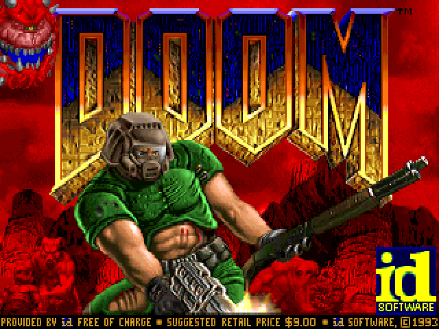
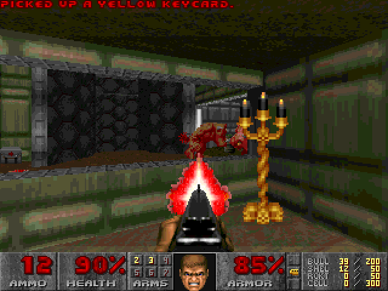

# TTDOOM




[STDOOM](https://github.com/indyjo/STDOOM) expanded and accelerated for Atari TT 
and Falcon, by [Neil Rackett](https://neilrackett.com/atarist)

## Introduction

Welcome to TTDOOM: full screen, full colour DOOM on the Atari TT or Falcon, thanks to an optimised 68030 rendering pipeline that enables it to run at close to original speed at 320x240 in 256 colours.

## System requirements

- Atari TT or Falcon with at least 2MB RAM
- 5MB hard drive space

## How to play

- Download `TTDOOM.TOS` and `DOOM1.WAD` from the [releases page](https://neilrackett.com/atarist/atarist-stdoom).
- Copy them to your hard drive.
- Run `TTDOOM.TOS`.

## Features

- 320x240 in 256 colours
- Zoomed mode for higher performance (activate by reducing window size using = key or menu)
- DMA sound effects
- YM-2149 music
- Controllable with keyboard and mouse
- Network gameplay not supported

## Compiling

The easiest way to compile TTDOOM is to use [`atarist-toolkit-docker`](https://github.com/sidecartridge/atarist-toolkit-docker).

```bash
stcmd make
```

## Benchmark

- Rename `TTDOOM.TOS` to `TTDOOM.TTP`
- On start, enter parameters: `-timedemo demo3 -nosound`
- The demo plays. When it's finished, a message says:
  Error: timed 2134 gametics in x realtics
- x is the time elapsed in 1/35th of a second. Calculate FPS: 35\*2134/x

## Atari ST

This project also includes some of my abandoned STDOOM experiments, with various optimisations to nudge it closer to being playable on an ST, including:

- [DOOM Accelerator](sidecart/README.md) for [SidecarTridge Multi-device](https://sidecartridge.com) to handle C2P
- Auto switch to 16MHz+cache on Atari Mega STE
- Support for SFP-004 memory mapped FPU if you've installed a 68881 or 68882 FPU

They help a little, but If you really want to run DOOM on an ST, download [MD/DOOM](https://neilrackett.com/atarist/md-doom) for your SidecarT instead.
